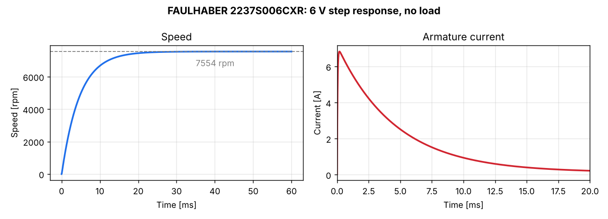
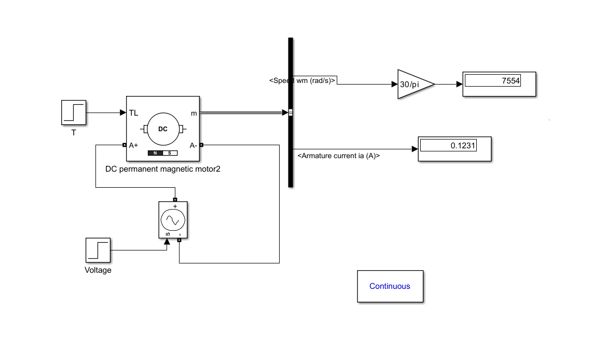

<div align="center">

# DC Motor Modeling & PI Speed Control

**First-principles modeling, Simulink validation and closed-loop speed control of a FAULHABER 2237S006CXR DC micromotor**




*6 V step response: the speed settles at **7554 rpm** with a mechanical time constant of **about 4.7 ms**, matching the 5 ms datasheet value.*

</div>

---

## Table of Contents
- [Overview](#overview)
- [Key Features](#key-features)
- [Motor Model](#motor-model)
- [Results](#results)
- [Speed Control](#speed-control)
- [Getting Started](#getting-started)
- [Project Structure](#project-structure)
- [Author](#author)

## Overview
Accurate actuator models are the foundation of every control design. This project builds a complete dynamic model of a **FAULHABER 2237S006CXR** brushed DC micromotor from datasheet values. It verifies that model through three independent derivations and a physical Simscape model, then uses it to design **PI speed controllers**.

## Key Features
- **Parameter identification** from the datasheet, including the friction coefficient estimated from the no-load operating point.
- **Transfer functions derived three ways:** analytically, by block algebra with `feedback()`, and by Simulink linearization. All three agree.
- **Partial-fraction analysis** that separates the fast electrical and slow mechanical dynamics.
- **Cross-validation** against the Simscape Electrical **DC Machine** block.
- **Closed-loop PI speed control** with several gain tunings and load-disturbance tests.
- **Thermal analysis** of the winding temperature rise (detailed in the report).

## Motor Model
The armature circuit and rotor mechanics are:

$$U = R_a i + L_a\frac{di}{dt} + k_\phi\,\omega \qquad J_m\frac{d\omega}{dt} = k_\phi i - B_m\omega - T_L$$

Combining them gives the speed transfer function:

$$\frac{\Omega(s)}{U(s)} = \frac{k_\phi}{L_aJ_m s^2 + (R_aJ_m + L_aB_m)s + (R_aB_m + k_\phi^2)}$$

| Parameter | Symbol | Value |
|-----------|--------|-------|
| Nominal voltage | U | 6 V |
| Armature resistance | Rₐ | 0.851 Ω |
| Armature inductance | Lₐ | 32.9 µH |
| Torque constant | k | 7.45 mNm/A |
| Rotor inertia | Jₘ | 3.1 gcm² |
| Viscous friction (derived) | Bₘ | 1.18 × 10⁻⁶ Nms |

## Results
| Quantity | Model | Datasheet |
|----------|-------|-----------|
| Speed constant | 1282 rpm/V | 1280 rpm/V |
| No-load speed | 7554 rpm | 7010 to 7540 rpm |
| No-load current | 0.125 A | 0.125 A |
| Electrical time constant Tₑ | 38.7 µs | n/a |
| Mechanical time constant Tₘ | 4.7 ms | 5 ms |

<div align="center">


*The Simscape DC Machine model reproduces the transfer-function result: 7554 rpm and 0.123 A at no load.*
</div>

The model and the datasheet agree to within a few percent. The remaining differences come from losses the linear model leaves out, such as iron losses and brush friction.

## Speed Control
PI speed loops were built on both the transfer-function model and the DC Machine block, tracking references of **6000 rpm** and **175 rpm**. Several gain tunings were compared (Kp from 0.025 to 0.1025, Ki from 0.27 to 4.76), each against a step in load torque, to study the trade-off between response speed, overshoot and disturbance rejection.

## Getting Started

### Prerequisites
- MATLAB with **Simulink** and the **Control System Toolbox**
- **Simscape Electrical** (only for the DC Machine block models)

### Usage
```matlab
cd src
motor_model      % loads parameters, prints transfer functions, plots step response
```
Then open any model in `models/`. They use the parameters that `motor_model.m` loads into the workspace.

## Project Structure
```
dc-motor-modeling-pid-control/
├── src/
│   └── motor_model.m                              # Parameters, TFs, residues, time constants
├── models/
│   ├── motor_transfer_function.slx                # Motor from transfer-function blocks
│   ├── motor_dc_machine_block.slx                 # Motor using the Simscape DC Machine
│   ├── pi_speed_control_transfer_function.slx     # PI speed loops (TF model)
│   └── pi_speed_control_dc_machine_block.slx      # PI speed loops (DC Machine)
├── linearization/                                 # Model Linearizer sessions
├── images/                                        # Figures
└── docs/
    └── report.pdf                                 # Full derivation and analysis
```

## Author
**Abdallah Yasser**, Mechatronics Engineering
[GitHub](https://github.com/abdallahnafady54321-bit)

## License
This project is licensed under the MIT License. See [LICENSE](LICENSE) for details.
